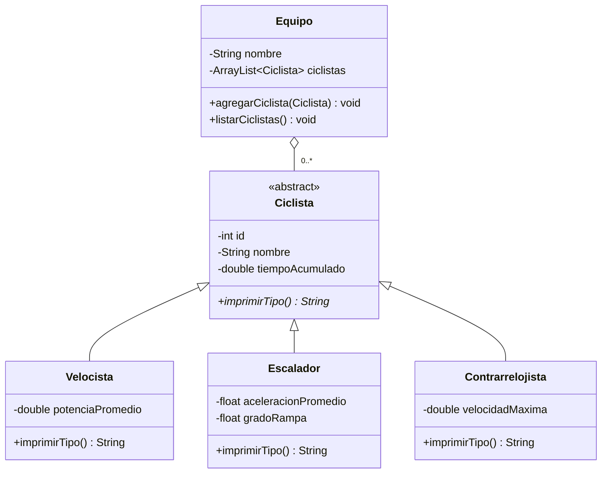

# Ejercicio Ciclistas

## Integrantes
- Daniel Toro
- Arnold Cabrera

## Descripción
Proyecto desarrollado en Java que representa diferentes tipos de ciclistas mediante programación orientada a objetos.

## Objetivo
Aplicar conceptos de programación orientada a objetos, como herencia, clases abstractas y polimorfismo, mediante la representación de distintos tipos de ciclistas.

## Tecnologías utilizadas
- Java
- Maven
- JUnit 5
- Git y GitHub
- Visual Studio Code

## Estructura del proyecto
- `Ciclista.java`: clase abstracta que representa un ciclista.
- `Velocista.java`: clase que representa un ciclista especializado en velocidad.
- `Escalador.java`: clase que representa un ciclista especializado en escalada.
- `Contrarrelojista.java`: clase que representa un ciclista especializado en pruebas contrarreloj.
- `Equipo.java`: clase encargada de gestionar los ciclistas del equipo.
- `Main.java`: clase principal del programa.
- `CiclistaTest.java`: pruebas unitarias de los tipos de ciclistas.

## Ejecución del proyecto
1. Tener instalado Java y Maven.
2. Abrir una terminal en la carpeta del proyecto.
3. Ejecutar el siguiente comando:

```bash
mvn clean compile
```

## Pruebas unitarias
Para ejecutar las pruebas unitarias con JUnit 5, utiliza:

```bash
mvn clean test
```

Las pruebas verifican que cada tipo de ciclista devuelva correctamente su identificación.

**Resultado esperado:** `BUILD SUCCESS`.

## Control de versiones
El proyecto utiliza Git para el control de versiones y GitHub para alojar el repositorio.

## Repositorio
https://github.com/Arnoldo1512/ciclismo


## Diagrama de clases



